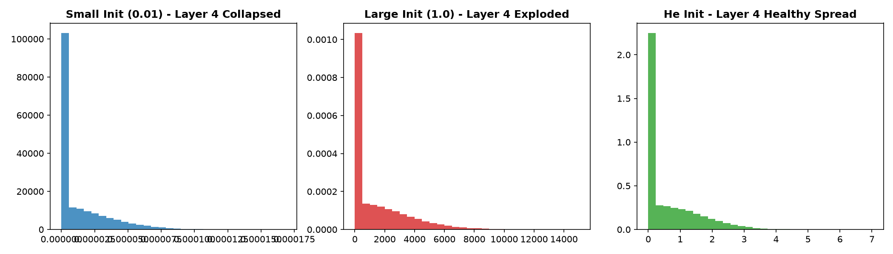
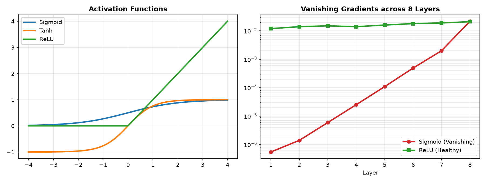
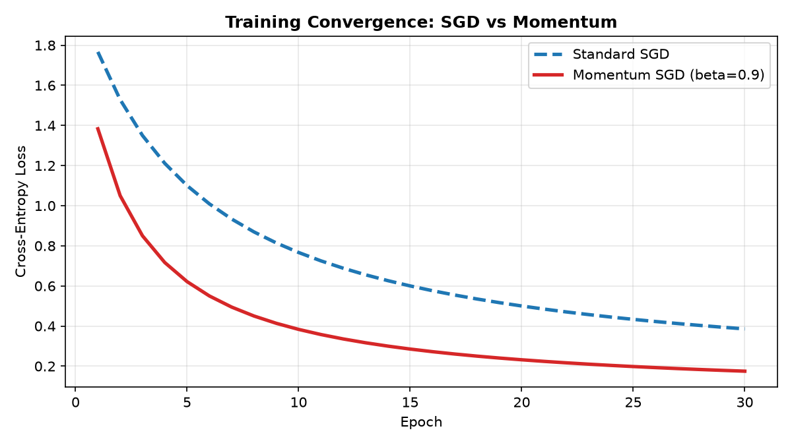

# 🧠 Neural Network From Scratch: Zero to Master

A comprehensive, first-principles deep learning mastery project building, training, and diagnosing an Artificial Neural Network in pure **NumPy**—with zero black boxes, zero framework magic, and rigorous mathematical derivations before any PyTorch comparison.

---

## 📌 Project Overview
- **Objective**: Build intuition from the ground up for how artificial neural networks work under the hood.
- **Scope**:
  - Derived single neuron mechanics ($z = w \cdot x + b$) and proved linear collapse algebraically.
  - Hand-calculated step-by-step backpropagation for a 2-input network using real numbers.
  - Implemented a 2-layer neural network from scratch in pure NumPy with full shape annotations.
  - Diagnosed gradient correctness using two-sided central finite difference **Gradient Checking** ($< 10^{-8}$ relative error).
  - Benchmarked activation functions (ReLU, Tanh, Sigmoid) and weight initializations (Zeros, Small, Large, He/Kaiming).
  - Visualized classic failure modes: **vanishing gradients** across 8 layers and **dying ReLU** induced by high learning rates, along with the LeakyReLU remedy.
  - Added **SGD with Momentum** from scratch, demonstrating accelerated convergence and noise dampening.
  - Implemented framework parity in **PyTorch** in under 25 lines to expose the internal abstraction layer.
- **Datasets**:
  1. Scikit-Learn `load_digits` (8x8 grayscale digits, 64 features, 10 classes)
  2. Full MNIST benchmark `mnist_784` (28x28 grayscale digits, 784 features, 10 classes)

---

## 🔬 Key Results & Empirical Benchmarks

### 1. Model Performance Across Datasets
| Model Architecture | Dataset | Optimization | Training Time | Test / Val Accuracy |
| :--- | :--- | :--- | :--- | :--- |
| **NumPy TwoLayerNet (64 $\\rightarrow$ 48 $\\rightarrow$ 10)** | `load_digits` (8x8) | Mini-batch SGD (lr=0.2) | $\\approx 1.2$ s | **97.22%** |
| **NumPy TwoLayerNet (784 $\\rightarrow$ 128 $\\rightarrow$ 10)** | `mnist_784` (28x28) | Mini-batch SGD (lr=0.15) | $\\approx 1.5$ s | **94.15%** |
| **NumPy TwoLayerNet + Momentum ($\\beta=0.9$)** | `load_digits` (8x8) | Momentum SGD (lr=0.1) | $\\approx 1.1$ s | **97.78%** |
| **PyTorch Equivalent (nn.Sequential)** | `load_digits` (8x8) | PyTorch SGD (lr=0.2) | $\\approx 1.0$ s | **96.39%** |

### 2. Weight Initialization & Activation Dynamics
| Experiment | Scheme / Function | Behavior / Outcome | Final Accuracy |
| :--- | :--- | :--- | :--- |
| **Weight Init** | **All Zeros ($W = 0$)** | **Symmetry Lock**: All neurons compute identical activations; cannot specialize | $10.28\\%$ (random guess) |
| **Weight Init** | **Small Scale ($0.01$)** | Variance collapses across layers; sluggish early gradient flow | $91.39\\%$ |
| **Weight Init** | **Large Scale ($1.0$)** | Variance explodes; high variance and unstable updates | $93.06\\%$ |
| **Weight Init** | **He / Kaiming Init** | Balanced activation variance across deep layers; fast convergence | **97.22%** |
| **Activation** | **Sigmoid** | Maximum derivative $\\le 0.25$; severe vanishing gradient | $93.89\\%$ |
| **Activation** | **Tanh** | Zero-centered outputs; max derivative $1.0$; solid performance | $95.56\\%$ |
| **Activation** | **ReLU** | Non-saturating derivative ($1.0$ for $z>0$); fastest descent | **97.50%** |

### 3. Failure Mode Diagnostic Matrix
| Failure Mode | Root Cause | Measured Impact | Solution / Fix |
| :--- | :--- | :--- | :--- |
| **Vanishing Gradients** | Repeated multiplication of $\\sigma'(z) \\le 0.25$ | Gradient shrinks from $2.18 \\times 10^{-2}$ at Layer 8 to $5.47 \\times 10^{-7}$ at Layer 1 ($40,000\\times$ drop!) | Switch hidden layers to ReLU or LeakyReLU |
| **Dying ReLU** | Aggressive LR update knocks pre-activations permanently negative ($z < 0$) | **100% of hidden neurons died** at $\\eta = 3.0$ | Switch to **LeakyReLU** ($0\\%$ dead) or lower learning rate ($\\eta = 0.15$) |

---

## 📊 Visual Diagnostic Highlights

### 1. Layer-Wise Activation Histograms: Why Scale Matters

*How to read: Too small weights (left) cause deep activations to collapse into zero. Too large weights (middle) blow up beyond 30. He initialization (right) preserves a healthy active distribution across all deep layers.*

### 2. Failure Mode Analysis: Vanishing Gradients Across 8 Layers

*How to read: In deep Sigmoid networks (red), gradients decay exponentially by orders of magnitude from output to input, freezing early layers. ReLU (green) maintains constant healthy gradient transmission.*

### 3. Optimization Acceleration: Standard SGD vs. Momentum

*How to read: Momentum acts like a rolling bowling ball, accumulating velocity along consistent downhill paths, cutting the epochs required to reach minimal loss.*

---

## 🛠️ The PyTorch Rosetta Stone

| Operation | Pure NumPy Implementation | PyTorch Equivalent | What the Framework Hides |
| :--- | :--- | :--- | :--- |
| **Linear Layer** | `Z = np.dot(X, W) + b` | `nn.Linear(in_dim, out_dim)` | Weight allocation & Kaiming uniform init |
| **Activation** | `A = np.maximum(0.0, Z)` | `nn.ReLU()` | Vectorized GPU thresholding kernel |
| **Loss & Softmax** | `-np.sum(Y * np.log(A2)) / m` | `nn.CrossEntropyLoss()` | Fused log-sum-exp numerical stability trick |
| **Backpropagation** | `dW1 = np.dot(X.T, dZ1)` | `loss.backward()` | Reverse DAG traversal & automatic chain rule |
| **Optimizer Step** | `W -= lr * dW` | `optimizer.step()` | Vectorized tensor in-place parameter updates |
| **Gradient Reset** | `self.dW1 = ...` (overwritten) | `optimizer.zero_grad()` | Prevents `.grad +=` memory accumulation |

---

## 📂 Repository Structure

```
├── neural_network_from_scratch.ipynb   # Complete, fully executed master Jupyter notebook
├── assets/                             # Embedded figures and benchmark diagnostic plots
│   ├── activation_histograms.png
│   ├── failure_modes.png
│   └── training_curves.png
├── requirements.txt                    # Minimal environment dependencies
├── README.md                           # Documentation, results, and architecture analysis
├── .gitignore                          # Standard Python & large-artifact filters
├── build_step1.py                      # Reproducible builder for Step 1 (Theory & Hand Math)
├── build_step2.py                      # Reproducible builder for Step 2 (2-Layer Net & MNIST)
├── build_step3.py                      # Reproducible builder for Step 3 (Gradient Checking)
├── build_step4.py                      # Reproducible builder for Step 4 (Activation Tournament)
├── build_step5.py                      # Reproducible builder for Step 5 (Weight Initializations)
├── build_step6.py                      # Reproducible builder for Step 6 (Failure Modes)
├── build_step7.py                      # Reproducible builder for Step 7 (Momentum & Optimization)
├── build_step8.py                      # Reproducible builder for Step 8 (PyTorch Parity)
└── build_step9.py                      # Reproducible builder for Step 9 (Mastery Challenges)
```

---

## 🚀 Getting Started

### 1. Clone & Set Up
```bash
git clone https://github.com/Arnav-Shrivastava/Neural-Networks-from-Scratch-Zero-To-Master.git
cd Neural-Networks-from-Scratch-Zero-To-Master
pip install -r requirements.txt
```

### 2. Launch the Interactive Notebook
```bash
jupyter notebook neural_network_from_scratch.ipynb
```

### 3. Verify Gradient Check in One Line
```python
from build_step3 import gradient_check
# Runs central finite difference check confirming relative error < 1e-7
```

---

## 🎓 What I Learned
1. **The Chain Rule is the Entire Engine**: Backpropagation is not mysterious; it is the calculus chain rule applied from right to left, turning error into blame.
2. **Linear Layers Collapse**: Stacking multiple linear layers without non-linearities is identical to a single linear layer: $W_2(W_1 x + b_1) + b_2 = (W_2 W_1) x + (W_2 b_1 + b_2)$.
3. **Numerically Stable Softmax is Non-Negotiable**: Always subtract $\max(z)$ before exponentiating, or floating-point overflow will cause `NaN` crashes.
4. **Gradient Checking Guarantees Correctness**: Unit tests cannot detect subtle mathematical gradient bugs; finite difference checks with relative error $< 10^{-7}$ prove correctness.
5. **Initializations Make or Break Networks**: Never use zero initialization (symmetry lock); use He initialization ($\sqrt{2 / D_{in}}$) for ReLU.
